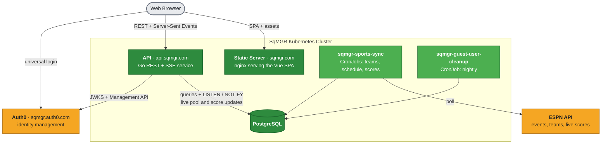
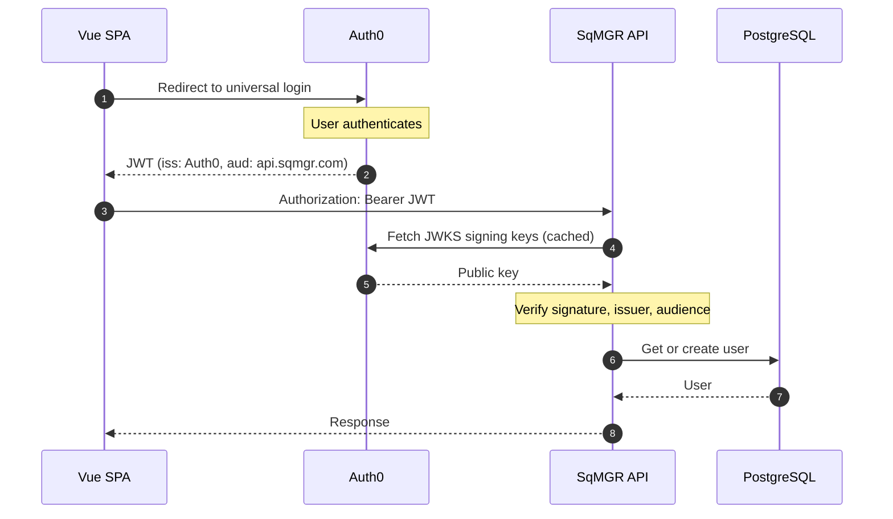
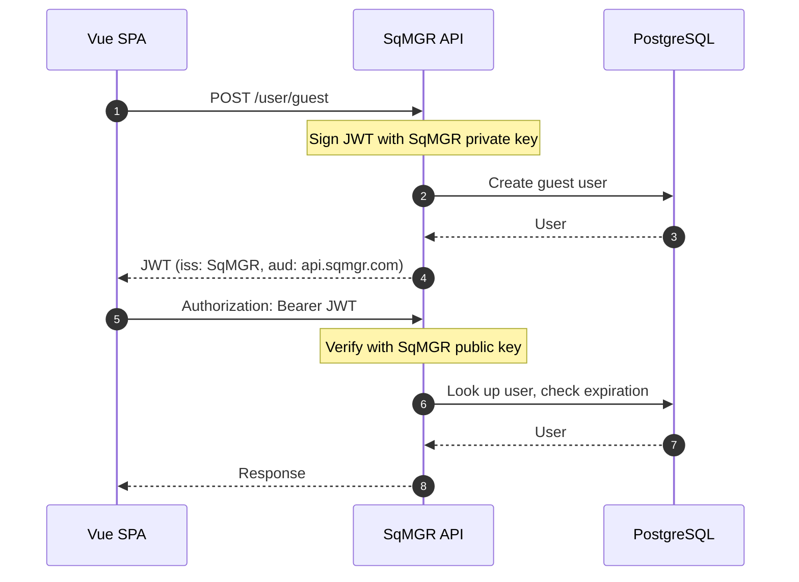

# SqMGR - Football Squares Pool Manager

[](https://github.com/sqmgr/sqmgr-vue/actions/workflows/main.yaml)
[](https://github.com/sqmgr/sqmgr-api/actions/workflows/main.yaml)
[](https://github.com/sqmgr/sqmgr-api/blob/master/go.mod)
[](https://github.com/sqmgr/sqmgr-vue/blob/master/package.json)
[](../LICENSE)

SqMGR is an open-source web application for managing football squares pools. Try it at [sqmgr.com](https://sqmgr.com).


## Repositories

Repository | Description | Status
--- | --- | ---
[sqmgr-vue](https://github.com/sqmgr/sqmgr-vue) | Vue.js frontend SPA | [](https://github.com/sqmgr/sqmgr-vue/actions/workflows/main.yaml)
[sqmgr-api](https://github.com/sqmgr/sqmgr-api) | Go backend REST API | [](https://github.com/sqmgr/sqmgr-api/actions/workflows/main.yaml)

## Quick Start

**Prerequisites:** Node.js 20+, Go 1.25+, Docker

```bash
# Start the API on http://localhost:8000
git clone git@github.com:sqmgr/sqmgr-api.git
cd sqmgr-api
make run           # generates JWT keys, starts PostgreSQL in Docker, migrates, runs the server
```

```bash
# Start the frontend on http://localhost:8080 (in a new terminal)
git clone git@github.com:sqmgr/sqmgr-vue.git
cd sqmgr-vue
npm install
npm run dev
```

Open [http://localhost:8080](http://localhost:8080) in your browser. The dev server talks to the API
at the URL in `.env` (`VITE_API_URL`, `http://localhost:8000` by default).

## Technology Stack

Component | Technology
--- | ---
Frontend | Vue 3.5 (Composition API), Vue Router 4, SCSS
Build tool | Vite 7
Backend | Go 1.25+
Database | PostgreSQL 11+
Auth | Auth0 (OAuth/OIDC) for members, RS256 JWTs issued by the API for guests
Live updates | Server-Sent Events backed by PostgreSQL `LISTEN`/`NOTIFY`
Sports data | ESPN, synced by scheduled jobs
Packaging | Docker images on GHCR, deployed to Kubernetes

## Architecture



SqMGR is a single-page application with a RESTful backend. An nginx container serves the built Vue
SPA; the SPA calls the Go API, which persists everything to PostgreSQL. Auth0 handles identity
management for registered users.

Three `sqmgr-sports-sync` CronJobs pull teams, schedules, and live scores from ESPN, and a nightly
CronJob purges expired guest accounts. Score and pool changes are broadcast to connected browsers
over Server-Sent Events, driven by PostgreSQL `LISTEN`/`NOTIFY` so any pod can publish an update.

Both components are built into container images by GitHub Actions, published to GHCR, and deployed
to Kubernetes.

## Authentication

SqMGR supports two user types, both authenticated with JWT bearer tokens scoped to the
`api.sqmgr.com` audience:

- **Registered Users** - Full accounts via Auth0 universal login (can create pools)
- **Guest Users** - Lightweight, expiring accounts for joining pools without registration

### Registered Users

Users authenticate through Auth0's hosted login page and receive a JWT. The API validates it against
Auth0's JWKS and looks up (or creates) the matching user record.



### Guest Users

Guests obtain a JWT by calling `POST /user/guest`. The API signs it with its own RSA key, so no
third-party round trip is needed.



## Features

### Pool Management
- **Create pools** with four grid types - 100 squares (10x10), 50 squares (5x10), 25 squares (5x5), or 100-square rollover
- **Multiple grids per pool** - up to 50 games in a single pool (ideal for playoffs or season-long pools)
- **Password protection** - optional password-secured pool access
- **Invite links** - shareable URLs with automatic pool joining
- **Pool locking** - freeze pools to prevent new claims while keeping them viewable
- **Drag-and-drop reordering** - organize games in your preferred order
- **Pool archiving** - soft-delete pools while preserving history

### Player Experience
- **Guest access** - join pools without creating an account using lightweight guest tokens
- **Claim squares** with automatic name persistence
- **Live updates** - Server-Sent Events push pool and score changes instantly
- **Square annotations** - add notes and icons to specific squares
- **Payment tracking** - mark squares as partially or fully paid
- **Activity log** - complete audit trail of all pool activity

### Grid Customization
- **Team customization** - set team names and colors for each side
- **Manual or random draws** - pick the numbers yourself or let SqMGR draw them
- **Number rotation** - one set of numbers for the whole game, or separate sets per period (1st/2nd/3rd/Final, or Half/Final)
- **Sports event linking** - connect grids to live ESPN events (NFL, NBA, WNBA, NCAAB, NCAAF)
- **Live scores** - automatic score updates and winner highlighting for linked games
- **Print-friendly layout** - optimized grid printing with branding support

### Admin & Statistics
- **Admin dashboard** - site-wide statistics and user management
- **User statistics** - track pools created, pools joined, and square claims
- **Time-based filtering** - view stats for the last hour, day, week, month, year, or all time

### Technical Features
- **Dual authentication** - Auth0 for registered users, SqMGR-signed JWTs for guests
- **Installable and mobile-responsive** - web app manifest for home-screen install; works on phones, tablets, and desktops
- **Rate limiting** - 10 req/s per IP, plus throttling of failed authentication attempts
- **RESTful API** - roughly 40 endpoints covering pools, grids, squares, sports data, and admin

## Contributing

Contributions are welcome! Please see the individual repository READMEs for development setup:

- [sqmgr-vue Getting Started](https://github.com/sqmgr/sqmgr-vue#getting-started)
- [sqmgr-api Getting Started](https://github.com/sqmgr/sqmgr-api#getting-started)

## License

GNU Affero General Public License v3 - See [LICENSE](../LICENSE) for details.
